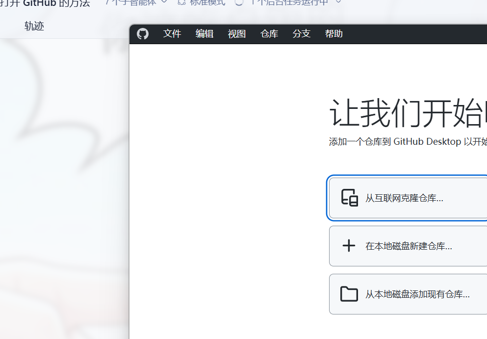
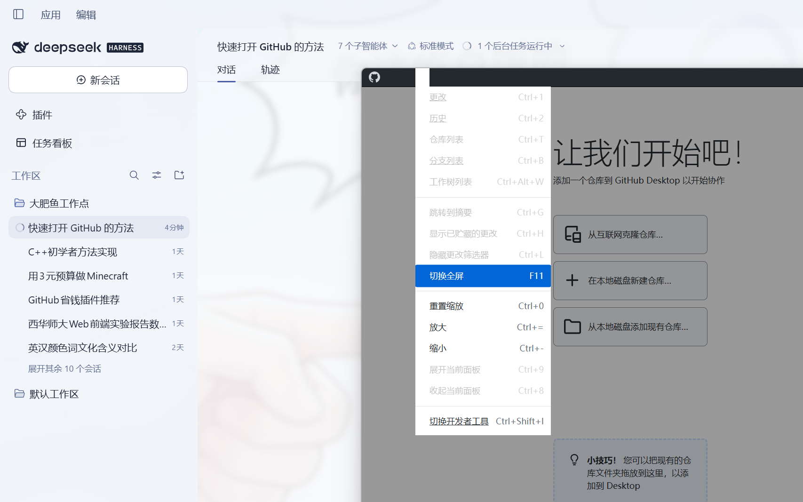
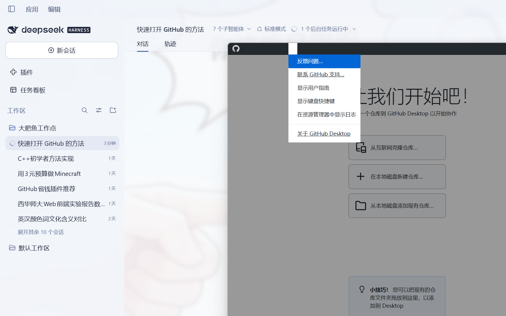

# GitHub Desktop 简体中文汉化（运行时翻译层）

给 **GitHub Desktop 3.6.7** 做的简体中文汉化。**不修改 `renderer.js`**，只在 `index.html`
里插一行加载器，用运行时 DOM 翻译层把界面英文换成中文，可随时一键还原。

> 非官方社区汉化，与 GitHub, Inc. 无关。GitHub Desktop 本身以 MIT 协议开源。





- 目标程序：`C:\Users\zhangjie\AppData\Local\GitHubDesktop\app-3.6.7\`
- 汉化资源：**全部在本目录（D 盘）**，C 盘只有那一行注入
- 词典规模：主词典 **1195** 条 + 菜单词典 **75** 条
- 实测覆盖：6 个应用菜单全部中文，欢迎页/工具栏/对话框按钮/提示全部中文，
  `untranslated.txt` 里可见文本与属性已无未翻译英文

---

## 一、安装 / 卸载

在 PowerShell 里（当前用户即可，不需要管理员）：

```powershell
# 安装
powershell -NoProfile -ExecutionPolicy Bypass -File D:\GitHub-Desktop-ZH\install.ps1

# 重装（会先删掉旧注入段再写）
powershell -NoProfile -ExecutionPolicy Bypass -File D:\GitHub-Desktop-ZH\install.ps1 -Force

# 卸载，完全恢复原样
powershell -NoProfile -ExecutionPolicy Bypass -File D:\GitHub-Desktop-ZH\uninstall.ps1
```

装完/卸完都要**重启 GitHub Desktop**（菜单里「退出」再打开，或在任务管理器里结束
`GitHubDesktop.exe`）。

`install.ps1` 会：

1. 自动找 `%LOCALAPPDATA%\GitHubDesktop\app-*`，取版本号最高的那个；
2. 首次安装时把原始 `index.html` 备份到 `backup\index.html.orig`；
3. 在 `<script defer src="renderer.js">` **之前**插入带 `<!--GHZH-INJECT-->` 标记的加载器。

---

## 二、文件说明

| 文件 | 作用 |
| --- | --- |
| `engine.js` | 翻译引擎：`MutationObserver` + 词典/正则规则，把 DOM 里的英文换成中文 |
| `i18n-zh.js` | 词典数据（`window.__GHZH_DICT__` / `window.__GHZH_MENU__`），由生成脚本产出 |
| `install.ps1` | 往 `index.html` 注入加载器（幂等，带备份） |
| `uninstall.ps1` | 精确删除注入段，还原英文 |
| `backup\index.html.orig` | 原始 `index.html` 备份 |
| `status.json` | 每次启动 8 秒后自动写的自检报告（已翻译节点数、词典条数、界面取样） |
| `_scratch\` | 构建与调试用的脚本（抽词、生成词典、离线测试、抓图），不参与运行 |

---

## 三、原理

GitHub Desktop 的 app 目录是**解包**的（没有 `app.asar`），`index.html` 只有一行：

```html
<script defer="defer" src="renderer.js"></script>
```

汉化就在它前面插一段：

```html
<!--GHZH-INJECT--><script>try{var fs=require("fs"),p='D:/GitHub-Desktop-ZH/';
(0,eval)(fs.readFileSync(p+"i18n-zh.js","utf8"));
(0,eval)(fs.readFileSync(p+"engine.js","utf8"))}catch(e){console.error("[GHZH] 汉化加载失败",e)}</script><!--/GHZH-INJECT-->
```

渲染进程开了 `nodeIntegration`，所以能用 `require('fs')` 从 **D 盘**读汉化文件——资源不落 C 盘。
引擎随后在 DOM 上工作：

- **精确匹配词典**：仓库名、分支名、提交信息、代码、diff 内容不可能恰好等于某条界面文案，
  所以不会被误伤；
- **正则规则**处理动态文案（`Commit 3 files to ` → `提交 3 个文件到 `、`Fetch origin` → `获取 origin`、
  `Pull 3 commits from the origin` → `从 origin 拉取 3 个提交` 等）；
- **菜单访问键特判**：菜单标签 `&File` 被渲染成 `<span class="sr-only">File</span>` +
  三个 `aria-hidden` 碎片 span（`F` + `ile`），可见文字根本拼不出整串。引擎识别这个结构、
  拿 `.sr-only` 的整串查菜单词典，一次替换；识别到结构就停止下钻，避免把碎片翻成半中半英；
- **不翻译的容器**：`code`/`pre`/`textarea`/`input`/`svg`、`.markdown-body`（README、issue 正文）、
  `.CodeMirror`/`.monaco-editor`、diff 行、`[contenteditable]`。

---

## 四、已知限制

1. **原生对话框翻不了**。`Push Rejected`、`Files Too Large`、`Unable to Locate Git` 这类是 Electron
   主进程弹的原生窗口，DOM 层够不到，保持英文。主进程还有 101 个菜单标签字面量，其中 35 个属于
   这类原生对话框/开发者菜单，已确认**可见菜单栏 100% 覆盖**。
2. **右键上下文菜单翻不了**，同上（原生 `Menu.popup`）。
3. **访问键提示符没了**。翻译后菜单项里不再显示 `文件(F)` 那样的下划线提示；但 `Alt+F`、`Alt+H`
   这些**快捷键本身仍然有效**（菜单数据来自主进程，没有被改）。
4. **GitHub Desktop 升级后会失效**。自动更新会新建 `app-<新版本>` 目录，注入不在里面。
   升级后重新跑一次 `install.ps1` 即可（词典是按界面文案匹配的，不绑版本，一般不用改）。

---

## 五、临时开关与自查

在 GitHub Desktop 里按 `Ctrl+Shift+I` 打开开发者工具，控制台里：

```js
__GHZH__.off()        // 立刻停用汉化（刷新后恢复英文）
__GHZH__.on()         // 重新启用
__GHZH__.count        // 已翻译的节点数
__GHZH__.report()     // 重新写一次 status.json
__GHZH__.collect()    // 把「界面上仍是英文」的文案写到 _scratch\untranslated.txt
```

`status.json` 是启动自检，正常长这样：

```json
{ "enabled": true, "translated": 13, "dictSize": 1195, "menuSize": 75,
  "samples": [ ".menu-item .label :: 文件 文件", "h1 :: 让我们开始吧！", ... ] }
```

---

## 六、词典怎么改

词都在 `_scratch\dict-merged.json`（主词典）和 `_scratch\dict-menu.json`（菜单词典）里，
改完重新生成即可：

```powershell
& "C:\Users\zhangjie\.dsh\dsh-runtimes\dsh-primary-runtime\dependencies\node\bin\node.exe" D:\GitHub-Desktop-ZH\_scratch\build.js
```

`build.js` 会丢弃「译文和原文完全相同」的条目，写出 `i18n-zh.js`。
改完必须在 GitHub Desktop 里**重启**（或 `Ctrl+R` 重载窗口）才生效。

改引擎逻辑后可以先跑离线测试（用假的 `window/document` 跑引擎，断言 26 条用例）：

```powershell
& "...\node.exe" D:\GitHub-Desktop-ZH\_scratch\test-engine.js
```

---

## 七、许可与声明

- 本项目（翻译引擎、词典、安装脚本）以 **MIT** 协议发布，见 [LICENSE](LICENSE)。
- 词典里的英文原文来自 **GitHub Desktop**（Copyright © GitHub, Inc.，MIT 协议），
  中文译文由本项目机器翻译后人工校对。本项目与 GitHub, Inc. 无任何关联，也未获其背书。
- 汉化方式是运行时替换界面文本，**不修改也不分发 GitHub Desktop 的任何程序文件**。
  卸载即恢复原样。

## 八、截图

| 欢迎页 | 视图菜单 | 帮助菜单 |
| --- | --- | --- |
|  |  |  |
